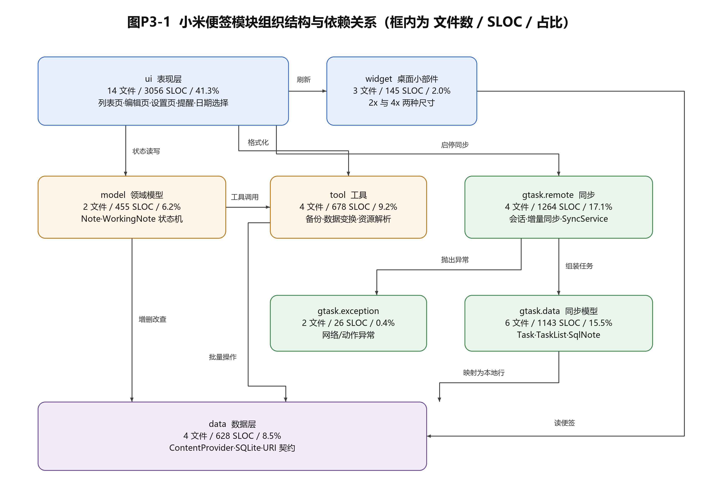
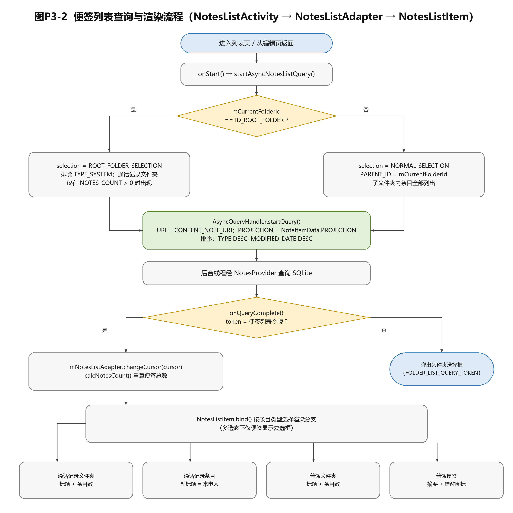

## 2.1 软件功能构成

MiCode/Notes 是一个单机优先的便签应用：数据保存在本机 SQLite，可选绑定 Google Tasks 账户做云端同步。功能按用户可感知的行为可归为 9 项，每项都能对应到具体类：

| # | 功能 | 用户可见行为 | 主要承载类 | 数据落点 |
|---|---|---|---|---|
| 1 | 便签列表浏览 | 首页按文件夹聚合展示，根目录同时列出文件夹与便签，按修改时间倒序 | `NotesListActivity`、`NotesListAdapter`、`NotesListItem` | `content://notes/note` |
| 2 | 便签编辑 | 新建/修改正文、背景色、字号、勾选清单 | `NoteEditActivity`、`NoteEditText`、`WorkingNote` | `note` + `data` 两表 |
| 3 | 文件夹管理 | 新建、重命名、删除文件夹；长按多选后批量移动/删除 | `NotesListActivity`、`FoldersListAdapter`、`DataUtils` | `note` 表 `parent_id` |
| 4 | 提醒 | 给便签设置提醒时间，到点弹窗；开机后重建闹钟 | `DateTimePicker(Dialog)`、`AlarmReceiver`、`AlarmInitReceiver`、`AlarmAlertActivity` | `note` 表 `alert_date` |
| 5 | 搜索 | 顶部搜索框（含全局搜索）输入关键词，点结果直达便签 | 系统 `SearchManager` + `NotesProvider` 的 suggest 路由 | `NOTES_SNIPPET_SEARCH_QUERY` |
| 6 | 桌面小部件 | 2x/4x 两种尺寸，显示单条便签，点击进入编辑 | `NoteWidgetProvider(_2x/_4x)` | `SharedPreferences` 存 id |
| 7 | Google Tasks 同步 | 绑定账户后手动同步/取消，增量拉取与推送，删除进回收站 | `GTaskSyncService`、`GTaskASyncTask`、`GTaskManager`、`GTaskClient` | `gtask_id`、`sync_id` 列 |
| 8 | 备份导出/导入 | 全部便签导出为 SD 卡上的 txt；从 txt 导入 | `BackupUtils` | 外部存储 |
| 9 | 通话记录关联 | 通话后快速记便签，列表中显示来电人 | `Contact`、`NotesProvider` | `data` 表通话相关列 |

功能与代码的对应关系不是一一映射：第 1、3 项都落在 `NotesListActivity` 里，第 4 项分散在 5 个类中，这也是第 4 章选取度量方法时优先考虑 `NotesListActivity` 的原因之一（单文件承担 3 类职责）。

## 2.2 编程语言与技术栈

- **语言**：Java（`AndroidManifest.xml:23` 声明 `minSdkVersion="14"`），无 Kotlin，无第三方依赖库；网络部分使用 Android 内置的 Apache HttpClient（`GTaskClient.java:35-39`）。
- **组件模型**：Activity（4 个界面）、Service（`GTaskSyncService`，同步任务）、BroadcastReceiver（小部件刷新 2 个 + 闹钟 2 个）、ContentProvider（`NotesProvider`，唯一的数据库出口）、AppWidgetProvider（小部件）。
- **存储**：SQLite 两张表 `note`（便签元信息/文件夹）与 `data`（正文内容），统一经 `NotesProvider` 暴露为 `content://notes/...`；配置类信息（同步账户、上次同步时间、说明是否已插入）用 `SharedPreferences`。
- **异步与线程**：界面侧用 `AsyncQueryHandler`（列表查询）与 `AsyncTask`（批量删除、导出）；同步侧自建 Service + 线程；跨界面用广播回传进度。
- **界面**：传统 View 体系（`ListView` + `CursorAdapter` + 自定义 `LinearLayout` 行视图），`ActionBar` 与 `ActionMode` 承担多选交互，未使用 Fragment 与 RecyclerView。

## 2.3 代码规模与包分布

规模数据统一取自孙浩的统计脚本 `deliverables/P2-sunhao/tools/measure.py` 输出（基线 commit `b94cc39`，2026-11-16），本章不重新统计，只做引用与解读：

| 度量项 | 数值 |
|---|---|
| Java 文件 | 39 |
| 命名类型 | 65（`summary.json` 字段 `named_types`，统计全部 `class`/`interface`/`enum` 声明；与第 1 章"45 类"的差异见该章口径说明） |
| 有效代码行（SLOC） | 7395（不含空行与注释） |
| 有实现的方法 | 448（不含构造器与接口声明） |
| 方法平均有效行 | 12.79 |

按 8 个子包拆分的规模分布如下（数字出自 `metrics/baseline/files.csv`，按 `sloc` 列聚合）：

| 子包 | 文件数 | SLOC | 占比 | 职责概述 |
|---|---:|---:|---:|---|
| `ui` | 14 | 3056 | 41.3% | 表现层：列表、编辑、设置、提醒、日期选择 |
| `gtask.remote` | 4 | 1264 | 17.1% | 同步会话、增量对比、SyncService |
| `gtask.data` | 6 | 1143 | 15.5% | 远端任务模型（Task/TaskList/SqlNote/MetaData） |
| `tool` | 4 | 678 | 9.2% | 备份导入导出、数据变换、资源解析 |
| `data` | 4 | 628 | 8.5% | ContentProvider、建表、URI 契约、联系人 |
| `model` | 2 | 455 | 6.2% | Note 与 WorkingNote 的编辑态模型 |
| `widget` | 3 | 145 | 2.0% | 桌面小部件 Provider |
| `gtask.exception` | 2 | 26 | 0.4% | 网络/动作两类自定义异常 |

`ui` 一个包占了 41.3% 的代码量，其中单个文件 `NotesListActivity.java` 就有 811 行有效代码（954 物理行），占全项目 11.0%；`NoteEditActivity.java` 为 710 有效行（873 物理行）。两个 Activity 合计占全项目 20.6%，是应用的主要复杂度来源。

图 P3-1 按"表现层 → 领域/工具层 → 同步层 → 数据层"分层给出各包的规模与主要依赖方向。图中箭头为按职责归纳的主要依赖；代码级 import 关系比图更密，且存在三处环依赖，见 2.4 节表 2-4-2。

## 2.4 模块职责与依赖关系

### 2.4.1 分层职责

- **数据层 `data`**：`NotesDatabaseHelper` 建表并维护升级脚本，`NotesProvider` 是唯一数据库出口，把 `content://notes/note`、`content://notes/data` 两类 URI 路由到两张表；`Notes` 类集中定义 URI、MIME、系统文件夹 id 与列名常量，是全项目的"数据契约"。该包不依赖任何上层包。
- **领域层 `model`**：`Note` 是内存中的一条便签，`WorkingNote` 负责编辑态的生命周期（创建草稿 → 改字段 → `saveNote()` 落库），是"界面改动"到"数据库行"之间的转换层。
- **工具层 `tool`**：`BackupUtils` 负责 txt 导入导出，`DataUtils` 封装批量删除/移动与文件夹计数，`ResourceParser` 把背景色 id 映射为资源，`GTaskStringUtils` 生成同步用的 JSON 片段。
- **同步层 `gtask.*`**：`gtask.data` 是远端模型（`Task`、`TaskList`、`SqlNote` 各自实现 `Node` 接口的 `getConflictObject`/`getCommitTime` 等），`gtask.remote` 负责登录、拉取、合并与写回，`GTaskSyncService` 作为常驻入口接收 `startSync/cancelSync` 意图。
- **表现层 `ui` + `widget`**：`ui` 承载四个界面与提醒，`widget` 只负责把小部件 id 与便签 id 的映射取出来渲染。

### 2.4.2 依赖关系与环依赖

依赖方向来自对基线全部 39 个文件的 `import` 语句统计（基线 `b94cc39`，脚本见 05 记录的验证方式）：

| 依赖方 | 被依赖方 | 是否成环 | 典型调用点 |
|---|---|---|---|
| `ui` | `data`、`model`、`tool`、`widget`、`gtask.remote` | 是（后三者） | `NotesListActivity.java:66-73` 同时 import 了同步服务与两个小部件 Provider |
| `gtask.remote` | `data`、`gtask.data`、`gtask.exception`、`tool`、`ui` | 是（`ui`） | `GTaskASyncTask.java:28-29` import 两个 ui Activity；`GTaskClient.java:33` import 设置页 |
| `gtask.data` | `data`、`tool`、`gtask.exception` | 否 | `SqlNote.java` 直接用 `Notes.NoteColumns` 拼 SQL |
| `model` | `data`、`tool` | 否 | `WorkingNote.java` 调 `DataUtils` 做批量更新 |
| `tool` | `data`、`ui` | 是（`ui`） | `DataUtils.java:32` import `NotesListAdapter.AppWidgetAttribute` |
| `widget` | `data`、`tool`、`ui` | 是（`ui`） | `NoteWidgetProvider.java:32-33` import `NoteEditActivity`、`NotesListActivity` |

由此得到三处环依赖，这也是本项目结构上最值得记录的问题：

1. **`ui` ↔ `gtask.remote`**：表现层直接调 `GTaskSyncService.startSync(this)`（`NotesListActivity.java:795`），同步层反向 import `NotesListActivity`（`GTaskASyncTask.java:28`）以在同步结束后跳转界面。同步进度因此只能靠广播（`GTaskSyncService.GTASK_SERVICE_BROADCAST_NAME`，`NotesPreferenceActivity.java:83`）解耦，属于"用广播给环依赖擦边"。
2. **`ui` ↔ `tool`**：`DataUtils` 为了返回小部件信息，直接依赖 ui 层的 `AppWidgetAttribute` 内部类；而 `DataUtils` 又被 `ui` 广泛调用。
3. **`ui` ↔ `widget`**：表现层 import 小部件 Provider 类来发定向更新广播（`NotesListActivity.java:72-73`、`updateWidget()` 691-708），小部件又 import Activity 来构造点击意图。

三处环的共同形态是"底层为了返回界面对象而反向依赖上层"。可行的改法是把 `AppWidgetAttribute` 提到 `model` 或 `data` 包、把界面跳转改为 `Intent` 常量或路由工具类，使依赖方向单向下行。这一条在报告第 3 章的问题清单中可继续展开，本章只做结构层面的记录。

## 2.5 关键程序流程

### 2.5.1 便签列表查询（含流程图）

这是全应用最常走的路径，从进入首页到列表项渲染完成共 9 步（见图 P3-2）：

1. `onCreate()`（138-148）只做视图初始化与"首次使用插入说明便签"，不查数据；
2. 每次回到前台，`onStart()`（206-210）调用 `startAsyncNotesListQuery()`，因此从编辑页返回能自动刷新；
3. `startAsyncNotesListQuery()`（411-418）按当前文件夹选择 `selection`：根目录用 `ROOT_FOLDER_SELECTION`（130-133），否则用 `NORMAL_SELECTION`（128）；
4. 通过 `mBackgroundQueryHandler.startQuery()` 发起异步查询，URI 为 `Notes.CONTENT_NOTE_URI`，投影为 `NoteItemData.PROJECTION`，排序为 `TYPE DESC, MODIFIED_DATE DESC`；
5. 后台线程经 `NotesProvider` 查询 SQLite（`NotesProvider.java` 的 `URI_NOTE` 分支）；
6. 查询完成回到 `onQueryComplete()`（426-441），按 token 分派：便签列表 → `changeCursor`，文件夹列表 → 弹选择框；
7. `NotesListAdapter.changeCursor()`（164-168）触发 `calcNotesCount()`（170-183）重算便签总数（不含文件夹），供"全选"判定；
8. `getView` → `bindView`（58-65）为每行构造 `NoteItemData` 并调用 `NotesListItem.bind()`（51-100）；
9. `bind()` 按类型进入四个渲染分支（通话记录文件夹 / 通话记录条目 / 普通文件夹 / 普通便签），再按位置选择圆角背景（102-117）。

两个边界条件值得注意：其一，根目录的 `ROOT_FOLDER_SELECTION` 里通话记录文件夹只有 `NOTES_COUNT > 0` 时才出现，所以空文件夹在首页"消失"，容易被误认为数据丢失；其二，`onQueryComplete` 对空游标不做判空（`changeCursor(null)` 是合法调用，等价于清空列表），因此"查询失败"和"没有数据"在界面上不可区分，这是第 3 章可提的问题之一。

### 2.5.2 文件夹切换与返回

- **进入**：`OnListItemClickListener.onItemClick`（879-918）在根目录状态下遇到文件夹类型条目，调用 `openFolder()`（543-558）——先改 `mCurrentFolderId`，再 `startAsyncNotesListQuery()`，最后按是否为通话记录文件夹设置 `mState`（`SUB_FOLDER` / `CALL_RECORD_FOLDER`）、标题栏文案与"新建"按钮可见性。顺序不能颠倒：查询依赖 `mCurrentFolderId`。
- **返回**：`onBackPressed()`（668-689）按 `mState` 分派，子文件夹先回到根目录并重新查询，只有 `NOTE_LIST` 状态才真正退出；两个分支都要恢复标题栏与"新建"按钮，否则会出现"按钮消失但已回根目录"的错位。
- **批量移动**：多选后点"移动"，`startQueryDestinationFolders()`（920-936）查询可作目标的文件夹（排除回收站与当前文件夹，非根目录时并入根目录），结果由 `showFolderListMenu()`（444-463）呈现，确认后 `DataUtils.batchMoveToFolder` 一次性移动。

### 2.5.3 搜索

搜索没有独立 Activity，走系统搜索框架：菜单项 `menu_search`（812-814）→ `onSearchRequested()`（822-825）调用 `startSearch(null, false, null, false)` → 系统按 `AndroidManifest.xml` 的 `android.app.searchable` 元数据读取 `res/xml/searchable.xml`（`searchSuggestAuthority="notes"`，`includeInGlobalSearch="true"`）→ 请求落到 `NotesProvider` 的 `SearchManager.SUGGEST_URI_PATH_QUERY` 路由（`NotesProvider.java:60-61`）→ 用 `NOTES_SNIPPET_SEARCH_QUERY` 对摘要列做 `LIKE '%关键词%'` 匹配，并把 id 塞进 `SUGGEST_COLUMN_INTENT_EXTRA_DATA` → 用户点选结果后以 `ACTION_VIEW` 打开编辑页。

限制：只匹配 `note` 表的 `snippet` 摘要列（约 30 字），正文深处的关键词搜不到；`queryRewriteFromText` 模式下不支持分词，中文只能前缀或子串命中。这一点在报告第 3 章作为可用性问题列出。

### 2.5.4 设置（同步账户）

- 入口有两处：菜单"设置"（804-807）与"同步"在未配置账户时的引导跳转（792-803），最终都走 `startPreferenceActivity()`（873-877），用 `startActivityIfNeeded` 避免重复实例。
- 设置页 `NotesPreferenceActivity.onCreate()`（73-89）加载 `res/xml/preferences.xml`，注册同步进度广播接收器，并在列表顶部插入含同步按钮的 header。
- 账户项由 `loadAccountPreference()`（127-155）动态重建：未配置 → 弹账户选择框（201-255）；已配置 → 先给风险提示再允许更换或解绑（257-284）；正在同步 → 只提示不允许改。
- 绑定账户时 `setSyncAccount()`（291-319）除了写 `SharedPreferences`，还会开线程把全表 `gtask_id` 置空、`sync_id` 归零——这是为了避免旧账户的远端标识错绑到新账户；解绑走 `removeSyncAccount()`（321-341）做同样清理。
- 同步按钮由 `loadSyncButton()`（157-194）渲染：`GTaskSyncService.isSyncing()` 决定显示"立即同步"还是"取消"，未配置账户时按钮禁用。

## 2.6 本章数据来源与口径

- **规模与方法数据**：`deliverables/P2-sunhao/tools/measure.py` 的输出，基线 commit `b94cc39`（2026-11-16 21:09）。本章引用的具体文件为 `metrics/baseline/files.csv`（逐文件 `physical_lines` / `sloc`）、`summary.json`（`named_types`、`methods_with_body`、`mean_method_sloc`、`file_sloc`）。包级汇总按 `files.csv` 的 `sloc` 列自行加总，可复算。
- **源码位置**：所有 `文件:行号` 均指**未加注释的基线版本**（`b94cc39`）。本人分支 P3 加了中文注释后行号会整体下移，核对时请用 `git show b94cc39:<path>` 查看。
- **依赖关系**：对基线 39 个文件的 `import` 语句做统计得出（只统计 `net.micode.notes.*` 内部依赖），可复算；调用点行号同上为基线行号。
- **流程图**：节点与判定条件逐条对照 2.5.1 列出的方法实现，图与文一致；可编辑源文件与生成脚本一并提交（`03_流程与图表/`、`tools/make_diagrams.py`）。
- **口径说明**：本章所有占比的分母统一为 7395（有效代码行），分母不同会引起几个百分点的差异，引用时不要混用。任务书"约 40 个类、170 个方法"与实测数据（45 类、448 个有实现方法）的差异在第 1 章统一解释，本章不重复说明。
