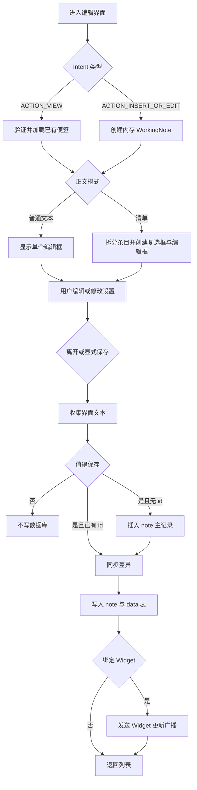
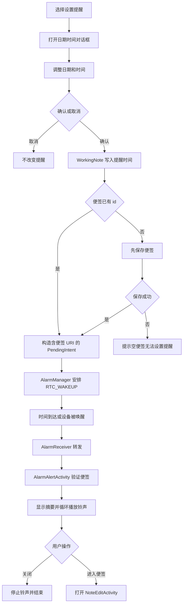

# P4 ui 编辑与提醒分析

## 1 工作范围与结果

P4 覆盖 `ui` 包中便签编辑、清单编辑、日期时间选择和提醒触发相关的 8 个文件。本次工作只增加中文注释和分析文档，不修改业务逻辑。

| 文件 | 主要职责 | 新增注释行 |
|---|---|---:|
| `NoteEditActivity.java` | 编辑界面生命周期、内容保存、清单模式、提醒与 Widget 联动 | 139 |
| `NoteEditText.java` | 清单项输入、回车拆行、退格合并和链接菜单 | 37 |
| `NoteItemData.java` | 列表查询结果映射、通话便签信息和游标位置判断 | 32 |
| `DateTimePicker.java` | 日期、小时、分钟、AM/PM 滚轮及跨日边界 | 66 |
| `DateTimePickerDialog.java` | 时间选择器包装、标题刷新和确认回调 | 16 |
| `AlarmAlertActivity.java` | 锁屏提醒、摘要展示、铃声播放和进入便签 | 39 |
| `AlarmInitReceiver.java` | 设备启动后重新注册未来提醒 | 22 |
| `AlarmReceiver.java` | 将系统闹钟广播转交给提醒界面 | 20 |
| 合计 |  | 371 |

## 2 文件职责与调用关系

### 2.1 编辑子模块

- `NoteEditActivity` 是编辑功能的协调中心。它根据 Intent 加载或创建 `WorkingNote`，把模型内容呈现为普通文本或清单，并在生命周期暂停、返回、新建下一条便签等节点触发保存。
- `NoteEditText` 是清单模式的单行输入控件。它不直接修改父容器，而是通过 `OnTextViewChangeListener` 把拆行、合并和空文本状态回调给 `NoteEditActivity`。
- `NoteItemData` 将列表查询得到的 Cursor 行复制为对象快照，供列表界面判断提醒、背景色、通话记录和分组边界。它依赖 `NoteEditActivity` 定义的清单状态字符来清洗摘要。

主要调用关系如下：

```text
NotesListActivity / 搜索结果 / Widget / 通话记录
    -> NoteEditActivity.initActivityState
        -> WorkingNote.load 或 WorkingNote.createEmptyNote
        -> NoteEditActivity.initNoteScreen
            -> 普通 EditText
            -> NoteEditText 清单项

NoteEditText 键盘事件
    -> OnTextViewChangeListener
        -> NoteEditActivity.onEditTextEnter
        -> NoteEditActivity.onEditTextDelete
        -> NoteEditActivity.onTextChange
```

### 2.2 提醒子模块

- `DateTimePicker` 保存真实的 `Calendar` 状态，并协调四个滚轮的首尾循环、12/24 小时转换和跨日变化。
- `DateTimePickerDialog` 汇总 Picker 回调并在标题中显示完整时间，用户确认后返回毫秒时间。
- `AlarmInitReceiver` 响应设备启动广播，查询尚未到期的普通便签并重新注册系统闹钟。
- `AlarmReceiver` 是轻量转发器，保留 Intent 中的便签 URI，启动 `AlarmAlertActivity`。
- `AlarmAlertActivity` 验证便签仍然存在，覆盖锁屏显示摘要并播放系统闹钟铃声。

主要调用关系如下：

```text
NoteEditActivity.setReminder
    -> DateTimePickerDialog
        -> DateTimePicker
        -> OnDateTimeSetListener
    -> WorkingNote.setAlertDate
    -> NoteEditActivity.onClockAlertChanged
    -> AlarmManager.set
    -> AlarmReceiver.onReceive
    -> AlarmAlertActivity
```

## 3 便签编辑保存完整链路

### 3.1 建立编辑状态

1. 打开已有便签时，`NoteEditActivity` 接收 `ACTION_VIEW`，从 `Intent.EXTRA_UID` 或搜索附加数据取得便签 id。
2. Activity 调用 `DataUtils.visibleInNoteDatabase` 验证记录仍然可见，然后通过 `WorkingNote.load` 加载便签及正文数据。
3. 新建便签时，Activity 接收 `ACTION_INSERT_OR_EDIT`，读取文件夹、Widget、背景色和通话记录参数，再调用 `WorkingNote.createEmptyNote` 建立内存对象。
4. 新建对象此时没有数据库 id；只有内容值得保存时才创建数据库记录，避免产生大量空便签。

### 3.2 从模型呈现到界面

1. `initNoteScreen` 根据 `WorkingNote.getCheckListMode` 选择普通文本或清单模式。
2. 普通模式把正文放入单个 `EditText`；从搜索结果进入时，匹配内容通过 `BackgroundColorSpan` 高亮，但原始字符串不改变。
3. 清单模式按换行拆分正文，再识别 `TAG_CHECKED` 和 `TAG_UNCHECKED` 前缀，为每行创建 `CheckBox + NoteEditText`。
4. 回车由 `NoteEditText.onKeyUp` 将当前行按光标拆分；行首退格则回调 Activity，将当前行内容并入上一行并重排索引。

### 3.3 从界面收集工作文本

1. 保存前统一调用 `NoteEditActivity.getWorkingText`。
2. 普通模式直接读取主编辑框字符串。
3. 清单模式遍历所有子 View，忽略空条目，并根据复选框状态重新加入勾选前缀和换行。
4. 汇总结果传给 `WorkingNote.setWorkingText`。只有内容真正发生变化时，模型才把正文写入 `Note` 的差异数据结构。

### 3.4 从模型写入存储

1. `NoteEditActivity.saveNote` 调用 `WorkingNote.saveNote`。
2. `WorkingNote.isWorthSaving` 排除已删除对象、没有内容的新便签以及没有任何差异的已有便签。
3. 新便签先通过 `Note.getNewNoteId` 向 `Notes.CONTENT_NOTE_URI` 插入主记录，取得稳定 id。
4. `WorkingNote` 调用 `Note.syncNote`：主表字段差异通过 `ContentResolver.update` 提交；正文或通话数据通过 `NoteData.pushIntoContentResolver` 插入或批量更新 `Notes.CONTENT_DATA_URI`。
5. `NotesProvider` 根据 URI 路由到 SQLite 的 `note` 表或 `data` 表，并发送内容变化通知。
6. 若便签绑定了桌面 Widget，保存成功后通过设置监听器回调 `onWidgetChanged`，发送指定 Widget id 的更新广播。
7. Activity 将结果设置为 `RESULT_OK`，列表页可据此刷新并决定保持原位置还是把新便签显示在顶部。

## 4 编辑便签流程

### 4.1 文字版步骤

1. 用户从列表、搜索结果、Widget 或通话记录进入编辑界面。
2. 系统根据 Intent 判断加载已有便签还是创建空的 `WorkingNote`。
3. Activity 按普通文本或清单模式重建编辑控件，并恢复背景色、字号、修改时间和提醒信息。
4. 用户编辑正文；清单模式下可新增、删除、合并或勾选条目。
5. 用户可以切换清单模式、背景色和字号。界面设置写入 `WorkingNote` 或用户偏好。
6. 用户按返回键、切换应用、创建下一条便签或系统保存 Activity 状态时触发保存。
7. Activity 收集当前控件文本，`WorkingNote` 判断是否有有效变化。
8. 新便签先插入主记录，随后主表和正文差异经 ContentProvider 写入 SQLite。
9. 如绑定 Widget，则发送刷新广播；最后返回列表并刷新展示。

### 4.2 流程图草稿



## 5 设置提醒流程

### 5.1 文字版步骤

1. 用户在编辑菜单中选择设置提醒。
2. `NoteEditActivity` 创建 `DateTimePickerDialog`，以当前时间作为初值。
3. 用户滚动日期、小时、分钟或 AM/PM；`DateTimePicker` 处理进位、退位和跨日，并把完整字段回传给对话框。
4. 用户确认后，对话框把最终毫秒时间交给 Activity，Activity 调用 `WorkingNote.setAlertDate`。
5. `WorkingNote` 记录提醒字段并回调 `onClockAlertChanged`。
6. 如果便签尚未保存，Activity 先保存便签以取得稳定 id；空便签无法取得 id 时提示用户。
7. Activity 使用便签 URI 构造 PendingIntent，并调用 `AlarmManager.set(RTC_WAKEUP)` 安排闹钟。
8. 时间到达后，系统唤醒 `AlarmReceiver`；Receiver 保留便签 URI并启动 `AlarmAlertActivity`。
9. 提醒 Activity 验证便签存在，显示摘要、覆盖锁屏并循环播放系统闹钟铃声。
10. 用户关闭对话框时停止并释放播放器；若屏幕已开启，用户还可以选择直接进入便签。
11. 用户删除提醒时，使用同一便签 URI 取得等价 PendingIntent 并调用 `AlarmManager.cancel`。
12. 设备重启后，`AlarmInitReceiver` 查询数据库中未来提醒并逐条重新注册。

### 5.2 流程图草稿



## 6 代码质量优点

### 6.1 界面与持久化职责分离

`NoteEditActivity` 只收集界面状态，`WorkingNote` 维护编辑期状态，`Note` 负责差异同步，`NotesProvider` 负责数据库路由。该分层避免 Activity 到处拼接 SQL，也使“空便签不保存”和“无变化不更新”等规则集中在模型层。

### 6.2 采用差异更新减少写入

`WorkingNote.setWorkingText` 仅在字符串变化时记录正文差异，`WorkingNote.saveNote` 也会过滤无变化对象。这样可减少数据库写入、内容通知和 Widget 刷新。

### 6.3 清单编辑事件职责清楚

`NoteEditText` 只判断键盘和焦点事件，通过接口通知 Activity；父容器负责 View 的插入、删除和重排。子控件不直接操作兄弟节点，降低了界面结构耦合。

### 6.4 提醒具有重启恢复机制

编辑页设置提醒后由 AlarmManager 调度，设备重启后 `AlarmInitReceiver` 又会从数据库恢复未来提醒，避免重启导致提醒永久丢失。

## 7 代码质量问题与改进建议

本节记录问题，不在本次只加注释的分支中修改业务代码。

### 7.1 12 小时制标题格式分支无效

- 现象：`DateTimePickerDialog.updateTitle` 中的条件表达式两个分支都使用 `DateUtils.FORMAT_24HOUR`。
- 位置：`src/net/micode/notes/ui/DateTimePickerDialog.java`，`updateTitle(long date)`。
- 原因：12 小时制分支可能是复制后未修改，导致 `mIs24HourView` 的条件判断没有实际效果。
- 影响：系统设置为 12 小时制时，对话框标题仍可能按照 24 小时制展示，与 Picker 或用户系统偏好不一致。
- 改进建议：`true` 分支保留 `FORMAT_24HOUR`，`false` 分支改为 `FORMAT_12HOUR`，并增加 00:00、12:00、13:00 三个边界测试。

### 7.2 搜索词被直接当作正则表达式

- 现象：`NoteEditActivity.getHighlightQueryResult` 直接执行 `Pattern.compile(userQuery)`。
- 位置：`src/net/micode/notes/ui/NoteEditActivity.java`，`getHighlightQueryResult(String fullText, String userQuery)`。
- 原因：用户输入本应按普通文本匹配，但没有使用 `Pattern.quote` 转义正则元字符，也没有捕获 `PatternSyntaxException`。
- 影响：搜索 `[`、`(`、`*` 等字符可能抛出异常；`.`、`+` 等字符则可能匹配超出用户预期的内容。
- 改进建议：若产品语义是文本搜索，使用 `Pattern.compile(Pattern.quote(userQuery))`；若确实支持正则搜索，应在输入层明确说明并捕获非法表达式。

### 7.3 提醒 Intent 缺少结构校验

- 现象：`AlarmAlertActivity.onCreate` 直接调用 `intent.getData().getPathSegments().get(1)`，只捕获 `IllegalArgumentException`。
- 位置：`src/net/micode/notes/ui/AlarmAlertActivity.java`，`onCreate(Bundle savedInstanceState)`。
- 原因：代码假定所有启动请求都来自本应用的 AlarmManager，没有检查 data 是否为空、路径段数量是否足够。
- 影响：异常 Intent、组件测试或系统恢复产生的不完整 Intent 可能触发 `NullPointerException` 或 `IndexOutOfBoundsException`，提醒界面直接崩溃。
- 改进建议：解析前验证 Intent、Uri 和路径段；失败时记录结构化日志并调用 `finish()`，不要只 `return` 留下空 Activity。

### 7.4 铃声异常处理只有自动生成占位代码

- 现象：`playAlarmSound` 的四个 catch 分支仍带有 `TODO Auto-generated catch block`，处理方式只有 `printStackTrace()`。
- 位置：`src/net/micode/notes/ui/AlarmAlertActivity.java`，`playAlarmSound()`。
- 原因：异常路径没有统一的日志、用户反馈、降级铃声或播放器状态清理策略。
- 影响：真实设备上铃声 URI 不可用、权限受限或 MediaPlayer 状态异常时，只出现无声提醒，且难以从正式日志定位原因。
- 改进建议：统一使用应用日志记录便签 id 和异常类型；失败时尝试通知铃声或振动降级；确保异常路径释放或重建 MediaPlayer。

## 8 边界条件与复核重点

- 新便签内容为空时不应写入数据库，也不能设置依赖便签 id 的提醒或桌面快捷方式。
- 清单首行不能继续向前合并；删除中间行后，后续 `NoteEditText` 索引必须连续。
- 分钟在 59 与 0 之间循环时应同步调整小时；小时跨越午夜时日期必须变化。
- 12 小时制应正确处理午夜 12 点、正午 12 点和下午时间。
- 已删除便签的旧闹钟被触发时，提醒 Activity 应验证失败并立即结束。
- 多条便签提醒使用相同 requestCode 时，必须依靠不同的 Intent.data 保持 PendingIntent 唯一。
- 设备重启后只恢复当前时间之后的普通便签提醒，不恢复过期提醒和文件夹记录。

## 9 AI 辅助与人工验证记录

### 9.1 AI 辅助范围

- 辅助梳理 8 个目标文件及 `WorkingNote`、`Note`、`NotesProvider` 的调用链。
- 辅助起草中文解释性注释、流程步骤、流程图草稿和质量问题候选。
- 辅助统计新增注释行，并检查 Git 差异是否涉及业务代码。

### 9.2 人工复核要求

- 逐段确认注释与源码实际行为一致，尤其是清单模式和日期滚轮边界。
- 复核两张流程图是否满足课程报告版式和符号规范。
- 在可用的旧版 Android 构建环境或设备上验证 12/24 小时制、空便签提醒和锁屏提醒。
- 由组内非主责成员复核问题结论；韩家阳建立 GitHub 账号后再补充线上 reviewer 记录。
