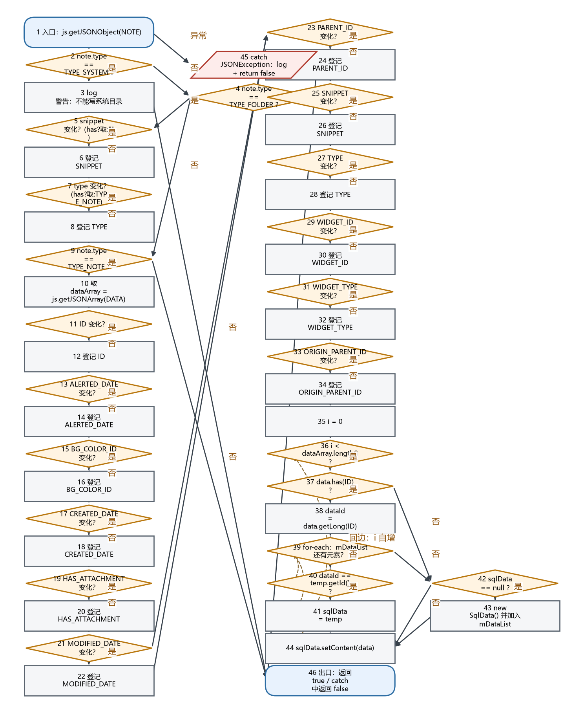
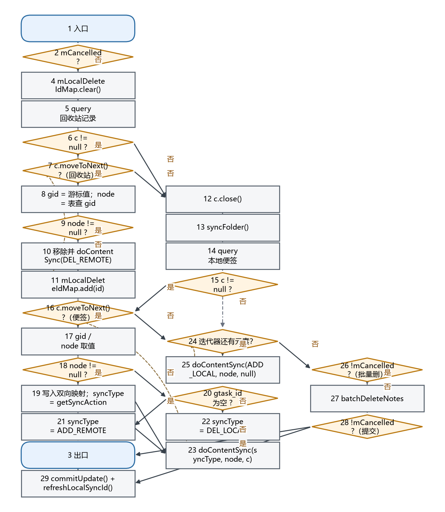
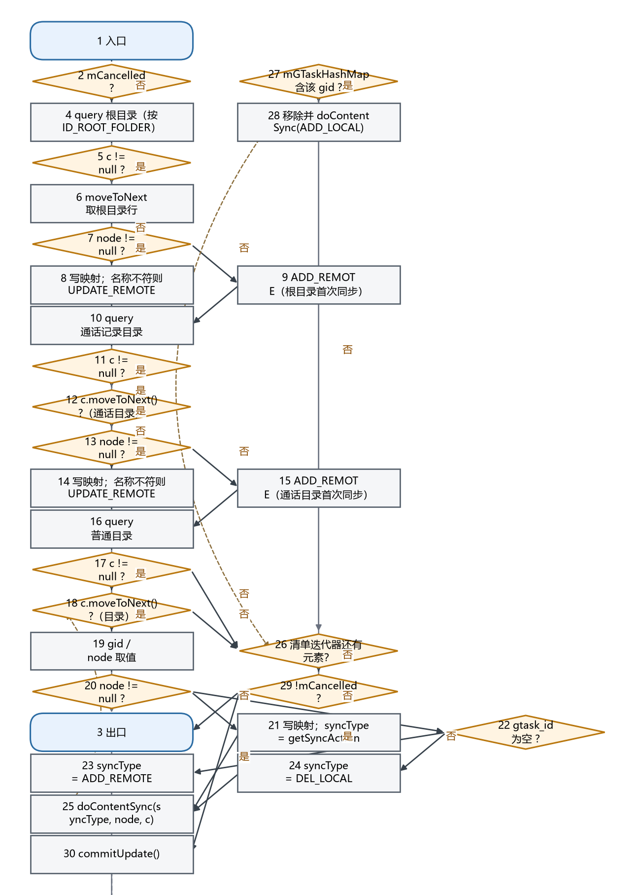
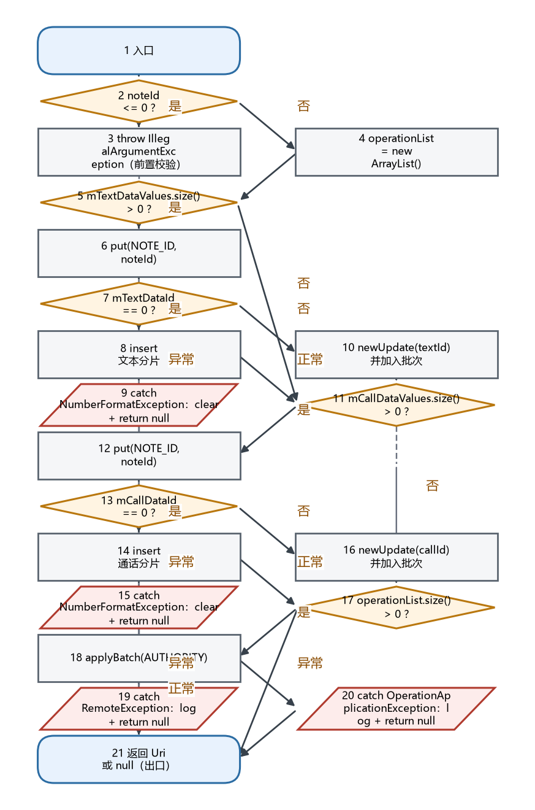
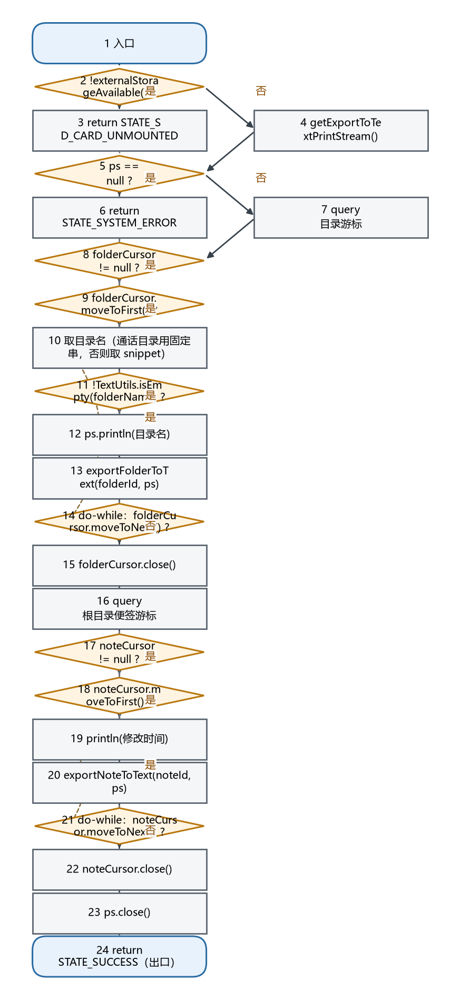

# P5 工作包分析：Google Tasks 同步与桌面小部件

> 项目：MiCode/Notes（Java/Android）　分支：feature/P5-gtask-widget　基线：b94cc39
> 本文档由分析脚本生成，图表与数据同源；AI 辅助与人工复核情况见 7.3。

## 1 工作包与文件范围

本工作包负责 MiCode/Notes（Java/Android）中 Google Tasks 同步与桌面小部件两块代码，共 15 个 Java 文件：gtask.data 6 个、gtask.remote 4 个、gtask.exception 2 个、widget 3 个。统计基线为组内统一口径的基线提交 b94cc39，统计脚本与本仓库 docs 中的说明一致：有效代码行为“非空行、非注释行”，含方法声明行与独立花括号行。

**表P5-1 文件规模与注释量（有效行口径）**

| 文件 | 原始行 | 有效行 | 新增注释行 |
|---|---|---|---|
| gtask/data/SqlNote.java | 505 | 402 | 54 |
| gtask/remote/GTaskManager.java | 800 | 635 | 84 |
| gtask/remote/GTaskClient.java | 585 | 451 | 60 |
| gtask/data/Task.java | 351 | 248 | 33 |
| gtask/data/TaskList.java | 343 | 249 | 33 |
| gtask/data/SqlData.java | 189 | 139 | 19 |
| gtask/remote/GTaskASyncTask.java | 123 | 87 | 12 |
| gtask/remote/GTaskSyncService.java | 128 | 91 | 12 |
| gtask/data/MetaData.java | 82 | 51 | 7 |
| gtask/data/Node.java | 101 | 54 | 8 |
| widget/NoteWidgetProvider.java | 132 | 98 | 14 |
| widget/NoteWidgetProvider_2x.java | 47 | 24 | 6 |
| widget/NoteWidgetProvider_4x.java | 46 | 23 | 6 |
| gtask/exception/ActionFailureException.java | 33 | 13 | 6 |
| gtask/exception/NetworkFailureException.java | 33 | 13 | 6 |
| 合计 | 3498 | 2578 | 360 |

注释只新增、不修改业务逻辑：15 个文件逐文件提交，git diff 删除行数为 0；去除注释后的代码字符序列与基线逐字节一致（校验脚本 annot_check.py），可排除“顺手改代码”的可能。注释量 360 行相当于有效代码行的 14.0%，低于组内规范建议的 25%（验收线 20%，对应 516 行），差异原因见 7.3 节说明。

## 2 Google Tasks 同步链路

同步的入口不在 gtask 包内，而在 ui 层：列表页菜单与设置页按钮都调用 GTaskSyncService.startSync(Activity)，后者把 Activity 交给 GTaskManager 以便取得账户 token，再以 Intent 启动服务；服务在 onStartCommand 中按 action 分流，startSync 创建 GTaskASyncTask 并 execute。整条链路是“UI → Service → AsyncTask → Manager → Client”。

### 2.1 登录与账户授权

GTaskClient.login 做三层短路判断：距上次登录不足 5 分钟则复用会话；若设置页记录的账户名与已登录账户不一致则强制重登（否则会拿旧账户 cookie 同步新账户）；邮箱后缀不是 gmail.com / googlemail.com 时先尝试企业域名端点 /tasks/a/<domain>/，失败再回落到官方端点。token 由 AccountManager 以 goanna_mobile 类型申请，失败时 invalidateAuthToken 后重试一次。登录响应的正文是 HTML，真正的会话参数藏在 _setup(…)}</script> 之间，代码用字符串定位后按 JSON 解析，取出 client_version，后续每个写请求都要原样带回。

### 2.2 拉取远端清单与任务

initGTaskList 先单独遍历一次清单列表，按名称前缀 “MIUI/” 且名为 “MIUI/meta” 定位元数据清单，再调 getTaskList(gid)（GET_ALL 动作）把 meta 全部读入 mMetaHashMap（以 related gid 为键）；若不存在则新建。第二遍遍历才装载其余 “MIUI/” 清单及其任务。两次遍历是刻意的：Task 的冲突判定依赖 meta 里的本地便签 JSON，若 meta 清单排在返回列表末尾，单遍遍历会让任务先于 meta 装载而退化为“最小 JSON 重建”。

### 2.3 映射为本地对象并写入数据库

远端对象到本地对象是一条单向的转换链：Task.setContentByRemoteJSON 读入 gid、名称、时间戳；Task.getLocalJSONFromContent 把远端内容拼成 {note:{…}, data:[…]} 结构；SqlNote.setContent 逐字段与当前值比较，只把变化的列登记进 mDiffNoteValues；SqlNote.commit 走 ContentProvider 写入 note 表，正文分片由 SqlData.commit 写入 data 表。反向（本地新增/修改）则由 SqlNote.getContent 生成同样的 JSON，交给 Task.setContentByLocalJSON 填回报文。

### 2.4 上传本地变化

本地修改并不逐条发送，而是先进 GTaskClient 的 mUpdateArray 攒批；addUpdateNode 在队列超过 10 条时先提交一批（请求体过大将被服务端拒绝），create / move / delete 之前也会强制提交一次，保证动作顺序与本地判定一致。跨清单移动必须单独发 move 请求，因为 update 报文没有 parent 字段。

### 2.5 删除与冲突处理

删除分两个方向：本地进入回收站（parent_id = ID_TRASH_FOLER）的记录按 DEL_REMOTE 处理，先把 id 累积进 mLocalDeleteIdMap，等整轮同步成功后再用 batchDeleteNotes 真正删库；远端已删除而本地还在的，按 DEL_LOCAL 处理，同时删掉它的 meta。冲突判定在 Node.getSyncAction：本地未改且远端未变返回 NONE，本地未改而远端变了返回 UPDATE_LOCAL，本地改了而远端未变返回 UPDATE_REMOTE，两边都改返回 UPDATE_CONFLICT。当前实现对 UPDATE_CONFLICT 直接按“本地覆盖远端”执行，源码注释也承认这是权宜之计，真正的字段级合并没有实现。目录则更简单：两边都改也按本地覆盖，不产生冲突码。

### 2.6 同步状态与异常反馈

GTaskManager.sync 在边界处把异常统一映射为状态码：NetworkFailureException → STATE_NETWORK_ERROR，ActionFailureException 与其它异常 → STATE_INTERNAL_ERROR；并发闸门 mSyncing 使重复触发直接返回 STATE_SYNC_IN_PROGRESS，用户取消则返回 STATE_SYNC_CANCELLED。GTaskASyncTask 在 onPostExecute 中按状态码选择通知文案，成功时写入 LastSyncTime；失败与取消的通知点击进入设置页，因为账户或网络配置错误是最常见的失败原因。

## 3 桌面小部件刷新链路

小部件不主动轮询，全部由广播驱动。链路是：便签保存 → WorkingNote 的监听器回调 → NoteEditActivity.updateWidget → 广播 ACTION_APPWIDGET_UPDATE（显式指定 2x / 4x 的 Provider 类，并带上 EXTRA_APPWIDGET_IDS）→ Provider.onUpdate → 按 widget_id 查便签 → 装配 RemoteViews → 挂 PendingIntent → 点击进入便签编辑界面。

几个容易忽略的细节：查询条件带 parent_id <> ID_TRASH_FOLER，已删除的便签不会继续显示在桌面；有便签时 Intent 带 ACTION_VIEW 与 EXTRA_UID（便签 id），空小部件则带 ACTION_INSERT_OR_EDIT，由编辑页新建后回写 widget 绑定；小部件被移除时 onDeleted 把该便签的 WIDGET_ID 复位为 INVALID，否则该便签会一直认为自己在桌面上，之后每次保存都向不存在的 widget 广播。

边界问题：AndroidManifest 为两个 Provider 声明了 android.intent.action.PRIVACY_MODE_CHANGED，但 NoteWidgetProvider 并未覆写 onReceive，privacyMode 参数没有任何入口能以 true 传入，L110–119 的“访客模式”分支实际不可达。另一个缺陷在 update 的同批次处理：当某个 widget_id 命中多条便签时（数据异常），代码记录错误后直接 return，导致同一批中排在后面的 widget 得不到刷新。

## 4 模块依赖关系

按源文件 import 关系统计（不含同包内部依赖），八个包之间的实际依赖如下表。统计口径为 Java import 语句条数，含静态导入，不含完全限定名内联调用。

**表P5-2 包级依赖矩阵**

| 源包 | 依赖包（条数） |
|---|---|
| gtask.data | data(14)、tool(5)、gtask.exception(4) |
| gtask.remote | gtask.data(8)、gtask.exception(4)、data(3)、tool(3)、ui(3) |
| gtask.exception | 无（仅依赖 JDK） |
| widget | data(4)、tool(3)、ui(2) |
| ui | data(16)、tool(10)、widget(4)、model(3)、gtask.remote(2) |
| model | data(11)、tool(1) |
| tool | data(7)、ui(2) |
| data | 无（最底层，仅依赖 Android API） |

依赖方向总体是“ui → 业务包 → data”，gtask.exception 与 data 处于底层，是干净的分层。但存在两处反向耦合，其中 ui 与 gtask.remote 构成双向依赖：

- gtask.remote → ui：GTaskClient 引用 NotesPreferenceActivity 读取同步账户；GTaskASyncTask 引用 NotesListActivity 与 NotesPreferenceActivity 构造通知的跳转意图。也就是说“同步”这一层为了做登录和通知，必须知道具体 Activity 类。
- ui → gtask.remote：NotesListActivity 与 NotesPreferenceActivity 直接调用 GTaskSyncService 的静态方法，并读取其静态状态（isSyncing / getProgressString）。
- widget ←→ ui：widget 引用 NoteEditActivity / NotesListActivity 做点击跳转，ui 的两个 Activity 又引用 Provider 类来发广播，同样是双向。

成因是一致的：这两个包都承担了“导航”职责——发起方需要知道目标页面，而目标页面又需要触发方提供的服务。在 Android 里导航与业务常被放在同一层，静态工具方法与 Activity 直接互指的成本很低，因此这种耦合在项目里自然生长出来。

影响有三点。其一，无法单独测试 gtask 层：编译或测试 gtask.remote 必须带上 ui 包与 Android 资源，任何 Activity 改签名都会波及同步模块。其二，静态状态（GTaskSyncService.mSyncTask）跨界面共享，状态的生命周期与界面生命周期不一致，容易出现“界面已销毁但广播仍到达”的情况。其三，可替换性差：若要把同步层抽成独立模块或换成 WorkManager，需要先把账户读取与通知跳转抽象成接口回调，改动会穿过 ui 与 gtask 两侧。

## 5 控制流图与 McCabe 度量

度量对象取组内统一清单（docs/submission-spec.md 第 25–35 行，对应 metrics/selected_five.csv）中的 5 个方法：SqlNote.setContent(116 行)、GTaskManager.syncFolder(109)、GTaskManager.syncContent(82)、Note.NoteData.pushIntoContentResolver(64)、BackupUtils.TextExport.exportToText(54)。需要说明的是：若严格按有效代码行排序，第 4、5 名应为 NotesListActivity.showCreateOrModifyFolderDialog(72) 与 NoteEditActivity.initActivityState(69)，两者都在 ui 包（P4 工作包范围）；组内为保证 LOC、操作符、McCabe 三种度量针对同一组方法，改用 model 与 tool 包的两个方法，本报告沿用该清单。

### 5.1 计数口径

- 节点：顺序执行的语句块合并为一个节点；函数入口与出口各一个节点。
- 判定节点：if / else-if / for / while / do-while / 每个 case 各计 1；catch 子句各计 1（异常路径单独成边）。
- 复合条件：&& 与 || 不单独建节点，与其所在判定合并计 1；理由是其短路求值不改变块级控制流，且这样能保证“判定条目数 + 1”与“E − N + 2P”严格相等。若逐短路点展开，setContent 的 V(G) 将增至 40 以上，本报告在 5.6 节给出该敏感性说明。
- 三元表达式：与其所在赋值语句合并为一个处理节点，不单独计判定。
- P：连通分量数；五个方法均为单入口单出口的连通图，P = 1。

### 5.2 SqlNote.setContent

位置：SqlNote.java:229-360（gtask.data 包），有效代码行 116 行。控制流图见图P5-1。

*图P5-1 SqlNote.setContent 的控制流图*

**表P5-1  SqlNote.setContent 节点表**

| 节点 | 内容 | 首个后继 |
|---|---|---|
| 1 | 入口：js.getJSONObject(NOTE) | 2 |
| 2 | note.type == TYPE_SYSTEM ? | 3 |
| 3 | log 警告：不能写系统目录 | 46 |
| 4 | note.type == TYPE_FOLDER ? | 5 |
| 5 | snippet 变化？(has?取:"" ) | 6 |
| 6 | 登记 SNIPPET | 7 |
| 7 | type 变化？(has?取:TYPE_NOTE) | 8 |
| 8 | 登记 TYPE | 9 |
| 9 | note.type == TYPE_NOTE ? | 10 |
| 10 | 取 dataArray = js.getJSONArray(DATA) | 11 |
| 11 | ID 变化？ | 12 |
| 12 | 登记 ID | 13 |
| 13 | ALERTED_DATE 变化？ | 14 |
| 14 | 登记 ALERTED_DATE | 15 |
| 15 | BG_COLOR_ID 变化？ | 16 |
| 16 | 登记 BG_COLOR_ID | 17 |
| 17 | CREATED_DATE 变化？ | 18 |
| 18 | 登记 CREATED_DATE | 19 |
| 19 | HAS_ATTACHMENT 变化？ | 20 |
| 20 | 登记 HAS_ATTACHMENT | 21 |
| 21 | MODIFIED_DATE 变化？ | 22 |
| 22 | 登记 MODIFIED_DATE | 23 |
| 23 | PARENT_ID 变化？ | 24 |
| 24 | 登记 PARENT_ID | 25 |
| 25 | SNIPPET 变化？ | 26 |
| 26 | 登记 SNIPPET | 27 |
| 27 | TYPE 变化？ | 28 |
| 28 | 登记 TYPE | 29 |
| 29 | WIDGET_ID 变化？ | 30 |
| 30 | 登记 WIDGET_ID | 31 |
| 31 | WIDGET_TYPE 变化？ | 32 |
| 32 | 登记 WIDGET_TYPE | 33 |
| 33 | ORIGIN_PARENT_ID 变化？ | 34 |
| 34 | 登记 ORIGIN_PARENT_ID | 35 |
| 35 | i = 0 | 36 |
| 36 | i < dataArray.length() ? | 37 |
| 37 | data.has(ID) ? | 38 |
| 38 | dataId = data.getLong(ID) | 39 |
| 39 | for-each：mDataList 还有元素？ | 40 |
| 40 | dataId == temp.getId() ? | 41 |
| 41 | sqlData = temp | 39 |
| 42 | sqlData == null ? | 43 |
| 43 | new SqlData() 并加入 mDataList | 44 |
| 44 | sqlData.setContent(data) | 36 |
| 45 | catch JSONException：log + return false | 46 |
| 46 | 出口：返回 true / catch 中返回 false | — |

**表P5-1  SqlNote.setContent 边清单（68 条）**

| 边 | 条件 | 类型 |
|---|---|---|
| 1 → 2 | — |  |
| 2 → 3 | 是 |  |
| 2 → 4 | 否 |  |
| 3 → 46 | — |  |
| 4 → 5 | 是 |  |
| 4 → 9 | 否 |  |
| 5 → 6 | 是 |  |
| 5 → 7 | 否 |  |
| 6 → 7 | — |  |
| 7 → 8 | 是 |  |
| 7 → 9 | 否 |  |
| 8 → 9 | — |  |
| 9 → 10 | 是 |  |
| 9 → 46 | 否 |  |
| 10 → 11 | — |  |
| 11 → 12 | 是 |  |
| 11 → 13 | 否 |  |
| 12 → 13 | — |  |
| 13 → 14 | 是 |  |
| 13 → 15 | 否 |  |
| 14 → 15 | — |  |
| 15 → 16 | 是 |  |
| 15 → 17 | 否 |  |
| 16 → 17 | — |  |
| 17 → 18 | 是 |  |
| 17 → 19 | 否 |  |
| 18 → 19 | — |  |
| 19 → 20 | 是 |  |
| 19 → 21 | 否 |  |
| 20 → 21 | — |  |
| 21 → 22 | 是 |  |
| 21 → 23 | 否 |  |
| 22 → 23 | — |  |
| 23 → 24 | 是 |  |
| 23 → 25 | 否 |  |
| 24 → 25 | — |  |
| 25 → 26 | 是 |  |
| 25 → 27 | 否 |  |
| 26 → 27 | — |  |
| 27 → 28 | 是 |  |
| 27 → 29 | 否 |  |
| 28 → 29 | — |  |
| 29 → 30 | 是 |  |
| 29 → 31 | 否 |  |
| 30 → 31 | — |  |
| 31 → 32 | 是 |  |
| 31 → 33 | 否 |  |
| 32 → 33 | — |  |
| 33 → 34 | 是 |  |
| 33 → 35 | 否 |  |
| 34 → 35 | — |  |
| 35 → 36 | — |  |
| 36 → 37 | 是 |  |
| 36 → 46 | 否 |  |
| 37 → 38 | 是 |  |
| 37 → 42 | 否 |  |
| 38 → 39 | — |  |
| 39 → 40 | 是 |  |
| 39 → 42 | 否 |  |
| 40 → 41 | 是 |  |
| 40 → 39 | 否 | 回边 |
| 41 → 39 | — | 回边 |
| 42 → 43 | 是 |  |
| 42 → 44 | 否 |  |
| 43 → 44 | — |  |
| 44 → 36 | 回边：i 自增 | 回边 |
| 1 → 45 | 异常 |  |
| 45 → 46 | — |  |

入口为节点 1，出口为节点 46。N = 46，E = 68，P = 1，V(G) = E − N + 2P = 68 − 46 + 2 = 24；交叉校验：判定条目 23 个（if/for/while 22，catch 1），判定条目数 + 1 = 24，与 E − N + 2P 一致。

分支与循环分布在上述判定节点；异常路径为：无 catch 子句。循环回边在边清单中标注为“回边”，不参与分层布局。

**表P5-1  SqlNote.setContent 的 24 条独立路径（V(G) = 24）**

| 路径 | 节点序列 |
|---|---|
| P1 | 1→45→46 |
| P2 | 1→3→46 |
| P3 | 1→46 |
| P4 | 1→2→46 |
| P5 | 1→2→9→46 |
| P6 | 1→2→4→7→9→46 |
| P7 | 1→2→4→46 |
| P8 | 1→2→4→5→7→9→46 |
| P9 | 1→2→4→5→9→46 |
| P10 | 1→2→4→5→7→46 |
| P11 | 1→2→4→9→11→13→15→17→19→21→23→25→27→29→31→33→35→36→46 |
| P12 | 1→2→4→9→10→11→13→15→17→19→21→23→25→27→29→31→33→35→36→46 |
| P13 | 1→2→4→9→10→11→15→17→19→21→23→25→27→29→31→33→35→36→46 |
| P14 | 1→2→4→9→10→11→13→17→19→21→23→25→27→29→31→33→35→36→46 |
| P15 | 1→2→4→9→10→11→13→15→19→21→23→25→27→29→31→33→35→36→46 |
| P16 | 1→2→4→9→10→11→13→15→17→21→23→25→27→29→31→33→35→36→46 |
| P17 | 1→2→4→9→10→11→13→15→17→19→23→25→27→29→31→33→35→36→46 |
| P18 | 1→2→4→9→10→11→13→15→17→19→21→25→27→29→31→33→35→36→46 |
| P19 | 1→2→4→9→10→11→13→15→17→19→21→23→27→29→31→33→35→36→46 |
| P20 | 1→2→4→9→10→11→13→15→17→19→21→23→25→29→31→33→35→36→46 |
| P21 | 1→2→4→9→10→11→13→15→17→19→21→23→25→27→31→33→35→36→46 |
| P22 | 1→2→4→9→10→11→13→15→17→19→21→23→25→27→29→33→35→36→46 |
| P23 | 1→2→4→9→10→11→13→15→17→19→21→23→25→27→29→31→35→36→46 |
| P24 | 1→2→4→9→10→11→13→15→17→19→21→23→25→27→29→31→33→36→46 |

### 5.3 GTaskManager.syncContent

位置：GTaskManager.java:250-352（gtask.remote 包），有效代码行 82 行。控制流图见图P5-2。

*图P5-2 GTaskManager.syncContent 的控制流图*

**表P5-2  GTaskManager.syncContent 节点表**

| 节点 | 内容 | 首个后继 |
|---|---|---|
| 1 | 入口 | 2 |
| 2 | mCancelled ? | 3 |
| 3 | 出口 | — |
| 4 | mLocalDeleteIdMap.clear() | 5 |
| 5 | query 回收站记录 | 6 |
| 6 | c != null ? | 7 |
| 7 | c.moveToNext() ?（回收站） | 8 |
| 8 | gid = 游标值；node = 表查 gid | 9 |
| 9 | node != null ? | 10 |
| 10 | 移除并 doContentSync(DEL_REMOTE) | 11 |
| 11 | mLocalDeleteIdMap.add(id) | 7 |
| 12 | c.close() | 13 |
| 13 | syncFolder() | 14 |
| 14 | query 本地便签 | 15 |
| 15 | c != null ? | 16 |
| 16 | c.moveToNext() ?（便签） | 17 |
| 17 | gid / node 取值 | 18 |
| 18 | node != null ? | 19 |
| 19 | 写入双向映射；syncType = getSyncAction | 23 |
| 20 | gtask_id 为空 ? | 21 |
| 21 | syncType = ADD_REMOTE | 23 |
| 22 | syncType = DEL_LOCAL | 23 |
| 23 | doContentSync(syncType, node, c) | 16 |
| 24 | 迭代器还有元素？ | 25 |
| 25 | doContentSync(ADD_LOCAL, node, null) | 24 |
| 26 | !mCancelled ?（批量删） | 27 |
| 27 | batchDeleteNotes | 28 |
| 28 | !mCancelled ?（提交） | 29 |
| 29 | commitUpdate() + refreshLocalSyncId() | 3 |

**表P5-2  GTaskManager.syncContent 边清单（39 条）**

| 边 | 条件 | 类型 |
|---|---|---|
| 1 → 2 | — |  |
| 2 → 3 | 是 |  |
| 2 → 4 | 否 |  |
| 4 → 5 | — |  |
| 5 → 6 | — |  |
| 6 → 7 | 是 |  |
| 6 → 12 | 否 |  |
| 7 → 8 | 是 |  |
| 7 → 12 | 否 |  |
| 8 → 9 | — |  |
| 9 → 10 | 是 |  |
| 9 → 11 | 否 |  |
| 10 → 11 | — |  |
| 11 → 7 | — | 回边 |
| 12 → 13 | — |  |
| 13 → 14 | — |  |
| 14 → 15 | — |  |
| 15 → 16 | 是 |  |
| 15 → 24 | 否 |  |
| 16 → 17 | 是 |  |
| 16 → 24 | 否 |  |
| 17 → 18 | — |  |
| 18 → 19 | 是 |  |
| 18 → 20 | 否 |  |
| 19 → 23 | — |  |
| 20 → 21 | 是 |  |
| 20 → 22 | 否 |  |
| 21 → 23 | — |  |
| 22 → 23 | — |  |
| 23 → 16 | — | 回边 |
| 24 → 25 | 是 |  |
| 24 → 26 | 否 |  |
| 25 → 24 | — | 回边 |
| 26 → 27 | 是 |  |
| 26 → 28 | 否 |  |
| 27 → 28 | — |  |
| 28 → 29 | 是 |  |
| 28 → 3 | 否 |  |
| 29 → 3 | — |  |

入口为节点 1，出口为节点 29。N = 29，E = 39，P = 1，V(G) = E − N + 2P = 39 − 29 + 2 = 12；交叉校验：判定条目 11 个（if/for/while 11，catch 0），判定条目数 + 1 = 12，与 E − N + 2P 一致。

分支与循环分布在上述判定节点；异常路径为：无 catch 子句。循环回边在边清单中标注为“回边”，不参与分层布局。

**表P5-2  GTaskManager.syncContent 的 12 条独立路径（V(G) = 12）**

| 路径 | 节点序列 |
|---|---|
| P1 | 1→2→4→5→6→12→13→14→15→24→26→28→29 |
| P2 | 1→2→5→6→12→13→14→15→24→26→28→29 |
| P3 | 1→2→4→5→6→13→14→15→24→26→28→29 |
| P4 | 1→2→4→5→6→7→9→11→7→12→13→14→15→24→26→28→29 |
| P5 | 1→2→4→5→6→7→13→14→15→24→26→28→29 |
| P6 | 1→2→4→5→6→7→8→9→11→7→12→13→14→15→24→26→28→29 |
| P7 | 1→2→4→5→6→7→8→9→7→12→13→14→15→24→26→28→29 |
| P8 | 1→2→4→5→6→12→13→14→15→26→28→29 |
| P9 | 1→2→4→5→6→12→13→14→15→16→18→19→23→16→24→26→28→29 |
| P10 | 1→2→4→5→6→12→13→14→15→16→26→28→29 |
| P11 | 1→2→4→5→6→12→13→14→15→16→17→18→23→16→24→26→28→29 |
| P12 | 1→2→4→5→6→12→13→14→15→16→17→18→21→23→16→24→26→28→29 |

### 5.4 GTaskManager.syncFolder

位置：GTaskManager.java:354-477（gtask.remote 包），有效代码行 109 行。控制流图见图P5-3。

*图P5-3 GTaskManager.syncFolder 的控制流图*

**表P5-3  GTaskManager.syncFolder 节点表**

| 节点 | 内容 | 首个后继 |
|---|---|---|
| 1 | 入口 | 2 |
| 2 | mCancelled ? | 3 |
| 3 | 出口 | — |
| 4 | query 根目录（按 ID_ROOT_FOLDER） | 5 |
| 5 | c != null ? | 6 |
| 6 | moveToNext 取根目录行 | 7 |
| 7 | node != null ? | 8 |
| 8 | 写映射；名称不符则 UPDATE_REMOTE | 10 |
| 9 | ADD_REMOTE（根目录首次同步） | 10 |
| 10 | query 通话记录目录 | 11 |
| 11 | c != null ? | 12 |
| 12 | c.moveToNext() ?（通话目录） | 13 |
| 13 | node != null ? | 14 |
| 14 | 写映射；名称不符则 UPDATE_REMOTE | 16 |
| 15 | ADD_REMOTE（通话目录首次同步） | 16 |
| 16 | query 普通目录 | 17 |
| 17 | c != null ? | 18 |
| 18 | c.moveToNext() ?（目录） | 19 |
| 19 | gid / node 取值 | 20 |
| 20 | node != null ? | 21 |
| 21 | 写映射；syncType = getSyncAction | 25 |
| 22 | gtask_id 为空 ? | 23 |
| 23 | syncType = ADD_REMOTE | 25 |
| 24 | syncType = DEL_LOCAL | 25 |
| 25 | doContentSync(syncType, node, c) | 18 |
| 26 | 清单迭代器还有元素？ | 27 |
| 27 | mGTaskHashMap 含该 gid ? | 28 |
| 28 | 移除并 doContentSync(ADD_LOCAL) | 26 |
| 29 | !mCancelled ? | 30 |
| 30 | commitUpdate() | 3 |

**表P5-3  GTaskManager.syncFolder 边清单（42 条）**

| 边 | 条件 | 类型 |
|---|---|---|
| 1 → 2 | — |  |
| 2 → 3 | 是 |  |
| 2 → 4 | 否 |  |
| 4 → 5 | — |  |
| 5 → 6 | 是 |  |
| 5 → 10 | 否 |  |
| 6 → 7 | — |  |
| 7 → 8 | 是 |  |
| 7 → 9 | 否 |  |
| 8 → 10 | — |  |
| 9 → 10 | — |  |
| 10 → 11 | — |  |
| 11 → 12 | 是 |  |
| 11 → 16 | 否 |  |
| 12 → 13 | 是 |  |
| 12 → 16 | 否 |  |
| 13 → 14 | 是 |  |
| 13 → 15 | 否 |  |
| 14 → 16 | — |  |
| 15 → 16 | — |  |
| 16 → 17 | — |  |
| 17 → 18 | 是 |  |
| 17 → 26 | 否 |  |
| 18 → 19 | 是 |  |
| 18 → 26 | 否 |  |
| 19 → 20 | — |  |
| 20 → 21 | 是 |  |
| 20 → 22 | 否 |  |
| 21 → 25 | — |  |
| 22 → 23 | 是 |  |
| 22 → 24 | 否 |  |
| 23 → 25 | — |  |
| 24 → 25 | — |  |
| 25 → 18 | — | 回边 |
| 26 → 27 | 是 |  |
| 26 → 29 | 否 |  |
| 27 → 28 | 是 |  |
| 27 → 26 | 否 |  |
| 28 → 26 | — | 回边 |
| 29 → 30 | 是 |  |
| 29 → 3 | 否 |  |
| 30 → 3 | — |  |

入口为节点 1，出口为节点 30。N = 30，E = 42，P = 1，V(G) = E − N + 2P = 42 − 30 + 2 = 14；交叉校验：判定条目 13 个（if/for/while 13，catch 0），判定条目数 + 1 = 14，与 E − N + 2P 一致。

分支与循环分布在上述判定节点；异常路径为：无 catch 子句。循环回边在边清单中标注为“回边”，不参与分层布局。

**表P5-3  GTaskManager.syncFolder 的 14 条独立路径（V(G) = 14）**

| 路径 | 节点序列 |
|---|---|
| P1 | 1→2→4→5→10→11→16→17→26→29→30 |
| P2 | 1→2→5→10→11→16→17→26→29→30 |
| P3 | 1→2→4→5→7→8→10→11→16→17→26→29→30 |
| P4 | 1→2→4→5→11→16→17→26→29→30 |
| P5 | 1→2→4→5→6→7→10→11→16→17→26→29→30 |
| P6 | 1→2→4→5→10→11→17→26→29→30 |
| P7 | 1→2→4→5→10→11→12→14→16→17→26→29→30 |
| P8 | 1→2→4→5→10→11→12→17→26→29→30 |
| P9 | 1→2→4→5→10→11→12→13→16→17→26→29→30 |
| P10 | 1→2→4→5→10→11→16→17→29→30 |
| P11 | 1→2→4→5→10→11→16→17→18→20→21→25→18→26→29→30 |
| P12 | 1→2→4→5→10→11→16→17→18→29→30 |
| P13 | 1→2→4→5→10→11→16→17→18→19→20→25→18→26→29→30 |
| P14 | 1→2→4→5→10→11→16→17→18→19→20→23→25→18→26→29→30 |

### 5.5 Note.NoteData.pushIntoContentResolver

位置：Note.java:181-251（model 包），有效代码行 64 行。控制流图见图P5-4。

*图P5-4 Note.NoteData.pushIntoContentResolver 的控制流图*

**表P5-4  Note.NoteData.pushIntoContentResolver 节点表**

| 节点 | 内容 | 首个后继 |
|---|---|---|
| 1 | 入口 | 2 |
| 2 | noteId <= 0 ? | 3 |
| 3 | throw IllegalArgumentException（前置校验） | 21 |
| 4 | operationList = new ArrayList() | 5 |
| 5 | mTextDataValues.size() > 0 ? | 6 |
| 6 | put(NOTE_ID, noteId) | 7 |
| 7 | mTextDataId == 0 ? | 8 |
| 8 | insert 文本分片 | 9 |
| 9 | catch NumberFormatException：clear + return null | 21 |
| 10 | newUpdate(textId) 并加入批次 | 11 |
| 11 | mCallDataValues.size() > 0 ? | 12 |
| 12 | put(NOTE_ID, noteId) | 13 |
| 13 | mCallDataId == 0 ? | 14 |
| 14 | insert 通话分片 | 15 |
| 15 | catch NumberFormatException：clear + return null | 21 |
| 16 | newUpdate(callId) 并加入批次 | 17 |
| 17 | operationList.size() > 0 ? | 18 |
| 18 | applyBatch(AUTHORITY) | 19 |
| 19 | catch RemoteException：log + return null | 21 |
| 20 | catch OperationApplicationException：log + return null | 21 |
| 21 | 返回 Uri 或 null（出口） | — |

**表P5-4  Note.NoteData.pushIntoContentResolver 边清单（30 条）**

| 边 | 条件 | 类型 |
|---|---|---|
| 1 → 2 | — |  |
| 2 → 3 | 是 |  |
| 2 → 4 | 否 |  |
| 3 → 21 | — |  |
| 4 → 5 | — |  |
| 5 → 6 | 是 |  |
| 5 → 11 | 否 |  |
| 6 → 7 | — |  |
| 7 → 8 | 是 |  |
| 7 → 10 | 否 |  |
| 8 → 9 | 异常 |  |
| 8 → 11 | 正常 |  |
| 9 → 21 | — |  |
| 10 → 11 | — |  |
| 11 → 12 | 是 |  |
| 11 → 17 | 否 |  |
| 12 → 13 | — |  |
| 13 → 14 | 是 |  |
| 13 → 16 | 否 |  |
| 14 → 15 | 异常 |  |
| 14 → 17 | 正常 |  |
| 15 → 21 | — |  |
| 16 → 17 | — |  |
| 17 → 18 | 是 |  |
| 17 → 21 | 否 |  |
| 18 → 19 | 异常 |  |
| 18 → 20 | 异常 |  |
| 18 → 21 | 正常 |  |
| 19 → 21 | — |  |
| 20 → 21 | — |  |

入口为节点 1，出口为节点 21。N = 21，E = 30，P = 1，V(G) = E − N + 2P = 30 − 21 + 2 = 11；交叉校验：判定条目 10 个（if/for/while 6，catch 4），判定条目数 + 1 = 11，与 E − N + 2P 一致。

分支与循环分布在上述判定节点；异常路径为：无 catch 子句。循环回边在边清单中标注为“回边”，不参与分层布局。

**表P5-4  Note.NoteData.pushIntoContentResolver 的 11 条独立路径（V(G) = 11）**

| 路径 | 节点序列 |
|---|---|
| P1 | 1→2→3→21 |
| P2 | 1→2→21 |
| P3 | 1→2→5→11→17→21 |
| P4 | 1→2→4→5→7→8→9→21 |
| P5 | 1→2→4→5→17→21 |
| P6 | 1→2→4→5→6→7→9→21 |
| P7 | 1→2→4→5→6→7→11→17→21 |
| P8 | 1→2→4→5→6→7→8→21 |
| P9 | 1→2→4→5→6→7→8→17→21 |
| P10 | 1→2→4→5→11→13→14→15→21 |
| P11 | 1→2→4→5→11→21 |

### 5.6 BackupUtils.TextExport.exportToText

位置：BackupUtils.java:221-283（tool 包），有效代码行 54 行。控制流图见图P5-5。

*图P5-5 BackupUtils.TextExport.exportToText 的控制流图*

**表P5-5  BackupUtils.TextExport.exportToText 节点表**

| 节点 | 内容 | 首个后继 |
|---|---|---|
| 1 | 入口 | 2 |
| 2 | !externalStorageAvailable() ? | 3 |
| 3 | return STATE_SD_CARD_UNMOUNTED | 24 |
| 4 | getExportToTextPrintStream() | 5 |
| 5 | ps == null ? | 6 |
| 6 | return STATE_SYSTEM_ERROR | 24 |
| 7 | query 目录游标 | 8 |
| 8 | folderCursor != null ? | 9 |
| 9 | folderCursor.moveToFirst() ? | 10 |
| 10 | 取目录名（通话目录用固定串，否则取 snippet） | 11 |
| 11 | !TextUtils.isEmpty(folderName) ? | 12 |
| 12 | ps.println(目录名) | 13 |
| 13 | exportFolderToText(folderId, ps) | 14 |
| 14 | do-while：folderCursor.moveToNext() ? | 10 |
| 15 | folderCursor.close() | 16 |
| 16 | query 根目录便签游标 | 17 |
| 17 | noteCursor != null ? | 18 |
| 18 | noteCursor.moveToFirst() ? | 19 |
| 19 | println(修改时间) | 20 |
| 20 | exportNoteToText(noteId, ps) | 21 |
| 21 | do-while：noteCursor.moveToNext() ? | 19 |
| 22 | noteCursor.close() | 23 |
| 23 | ps.close() | 24 |
| 24 | return STATE_SUCCESS（出口） | — |

**表P5-5  BackupUtils.TextExport.exportToText 边清单（32 条）**

| 边 | 条件 | 类型 |
|---|---|---|
| 1 → 2 | — |  |
| 2 → 3 | 是 |  |
| 2 → 4 | 否 |  |
| 3 → 24 | — |  |
| 4 → 5 | — |  |
| 5 → 6 | 是 |  |
| 5 → 7 | 否 |  |
| 6 → 24 | — |  |
| 7 → 8 | — |  |
| 8 → 9 | 是 |  |
| 8 → 16 | 否 |  |
| 9 → 10 | 是 |  |
| 9 → 15 | 否 |  |
| 10 → 11 | — |  |
| 11 → 12 | 是 |  |
| 11 → 13 | 否 |  |
| 12 → 13 | — |  |
| 13 → 14 | — |  |
| 14 → 10 | 是 | 回边 |
| 14 → 15 | 否 |  |
| 15 → 16 | — |  |
| 16 → 17 | — |  |
| 17 → 18 | 是 |  |
| 17 → 23 | 否 |  |
| 18 → 19 | 是 |  |
| 18 → 22 | 否 |  |
| 19 → 20 | — |  |
| 20 → 21 | — |  |
| 21 → 19 | 是 | 回边 |
| 21 → 22 | 否 |  |
| 22 → 23 | — |  |
| 23 → 24 | — |  |

入口为节点 1，出口为节点 24。N = 24，E = 32，P = 1，V(G) = E − N + 2P = 32 − 24 + 2 = 10；交叉校验：判定条目 9 个（if/for/while 9，catch 0），判定条目数 + 1 = 10，与 E − N + 2P 一致。

分支与循环分布在上述判定节点；异常路径为：无 catch 子句。循环回边在边清单中标注为“回边”，不参与分层布局。

**表P5-5  BackupUtils.TextExport.exportToText 的 10 条独立路径（V(G) = 10）**

| 路径 | 节点序列 |
|---|---|
| P1 | 1→2→3→24 |
| P2 | 1→2→24 |
| P3 | 1→2→5→6→24 |
| P4 | 1→2→4→5→24 |
| P5 | 1→2→4→5→8→16→17→23→24 |
| P6 | 1→2→4→5→7→8→15→16→17→23→24 |
| P7 | 1→2→4→5→7→8→17→23→24 |
| P8 | 1→2→4→5→7→8→9→11→13→14→15→16→17→23→24 |
| P9 | 1→2→4→5→7→8→9→16→17→23→24 |
| P10 | 1→2→4→5→7→8→9→10→11→13→14→15→16→17→23→24 |

### 5.6 V(G) 汇总与敏感性

**表P5-6 McCabe 度量汇总**

| 方法 | 有效行 | N | E | P | V(G) | 判定+1 |
|---|---|---|---|---|---|---|
| SqlNote.setContent | 116 | 46 | 68 | 1 | 24 | 23+1=24 |
| GTaskManager.syncContent | 82 | 29 | 39 | 1 | 12 | 11+1=12 |
| GTaskManager.syncFolder | 109 | 30 | 42 | 1 | 14 | 13+1=14 |
| Note.NoteData.pushIntoContentResolver | 64 | 21 | 30 | 1 | 11 | 10+1=11 |
| BackupUtils.TextExport.exportToText | 54 | 24 | 32 | 1 | 10 | 9+1=10 |

五个方法的 V(G) 全部超过 10，按组内约定都需要给出重构建议（见第 6 章）。其中 SqlNote.setContent 的复杂度几乎全部来自 17 个字段的“取值—比较—登记”重复块，属于可机械消除的复杂度；GTaskManager 的两个方法则是查询游标与状态判断交织，复杂度来自分支数量而非嵌套深度。

口径敏感性：若把 && / || 的每个短路点与每个三元表达式都展开为判定节点，setContent 的判定条目将由 23 增至 45 左右，V(G) 约为 46；syncContent、syncFolder 各增加 2–3。本报告采用合并口径，理由是块级控制流不变，且与“基路径覆盖”的教学定义一致；两种口径的排序结论一致，不影响“哪些方法最复杂”的判断。

## 6 边界条件与改进建议

- SqlNote.setContent 的 17 段字段拷贝可以用“列名 → 取值函数”的映射表驱动，把复杂度从 O(字段数) 降到 O(1)，预计 V(G) 由 24 降到 8 以下。
- 冲突处理是当前最弱的一环：UPDATE_CONFLICT 直接本地覆盖远端，两台设备同时编辑会静默丢失远端修改；建议先比较两侧 modified_date，再按字段做三方合并，至少要把冲突记录暴露在同步结果里。
- getSyncAction 依赖“meta 里的 note id 与本地 id 一致”这一强假设，本地数据重建（清库、换设备）后会全部判为 UPDATE_LOCAL，造成远端内容覆盖本地。建议把 gid 作为主键比对，id 只作辅助校验。
- GTaskClient 的登录态用 5 分钟硬编码过期，且 client_version 只在登录时取一次；长时间后台同步中版本号可能失效，建议在 401 时重新登录并刷新版本号。
- 通知与进度依赖静态字段与广播，进程被回收后状态丢失；建议把同步状态持久化（数据库或 WorkManager 的 State），避免界面读到过期的“同步中”。
- 小部件的 privacyMode 分支不可达，属于死代码；同 widget_id 命中多条便签时直接 return 会跳过同批其余实例，应改为 continue。

## 7 验证记录与工作归属

### 7.1 已完成的验证

- git diff --check 通过，无空白字符问题。
- 15 个文件逐文件统计新增行：全部为注释行，新增代码 0 行，删除 0 行。
- 去除注释后的代码字符序列与基线一致（脚本 annot_check.py，逐文件 OK）。
- 注释起止符配平检查通过（无未闭合的 /* 或 */）。
- 五个方法的 V(G) 两种算法结果一致（E−N+2P 与 判定条目+1）。
- 图中节点编号、边清单与度量表由同一份模型（cfg_model.py）生成，不存在图文不一致。

### 7.2 未完成的验证

- 仓库缺少 Gradle / Maven / Ant 构建文件，无法执行 Android 编译，因此没有“编译通过”的结论。
- 基线本身存在语法缺陷：src/net/micode/notes/ui/NoteEditActivity.java:433 多出一个 “-” 字符（该行位于 P4 范围，本工作包未修改），即使补齐构建脚本也无法直接编译。
- 未在真机或模拟器上运行，小部件刷新、同步登录等运行时行为未经设备验证。
- 孙浩的人工复核尚未进行，本报告的度量数字与结论均为待复核状态。

### 7.3 工作归属与 AI 使用

- MiCode/Notes 原有业务代码：全部 15 个文件的实现逻辑，本工作包未新增、未删除、未修改任何一行。
- AI 辅助产出：360 行中文注释的初稿、同步链路与模块依赖分析、5 张控制流图及其节点/边表、McCabe 计算与独立路径、本报告与评测脚本。
- 本人完成：确定工作范围与分支、决定注释口径与度量口径、逐文件复核注释与代码是否对应、逐文件提交并推送至 fork 分支 wangyifande:P5-wangyifan、创建 PR #4、确认方法清单与组内一致。
- 尚未完成：孙浩的复核、设备验证、PR 评审意见（PR 已创建，但尚无评审意见与合并动作）。上述内容在报告中一律标注为“待复核”“待验证”，不写成已完成。

## 附录 A 复核要点清单

- SqlNote.setContent 的 24 条路径是否覆盖了 17 个字段块的全部分支组合（建议抽查 3 条）。
- GTaskManager.syncContent 的 P8–P12 是否与代码中两处 !mCancelled 判断对应。
- Note.NoteData.pushIntoContentResolver 的 4 个 catch 是否都单独计入了判定条目。
- 注释是否只解释了“为什么”，没有逐行翻译代码。
- 360 行与组内 20% 验收线的差距是否需要在统稿时统一说明。
